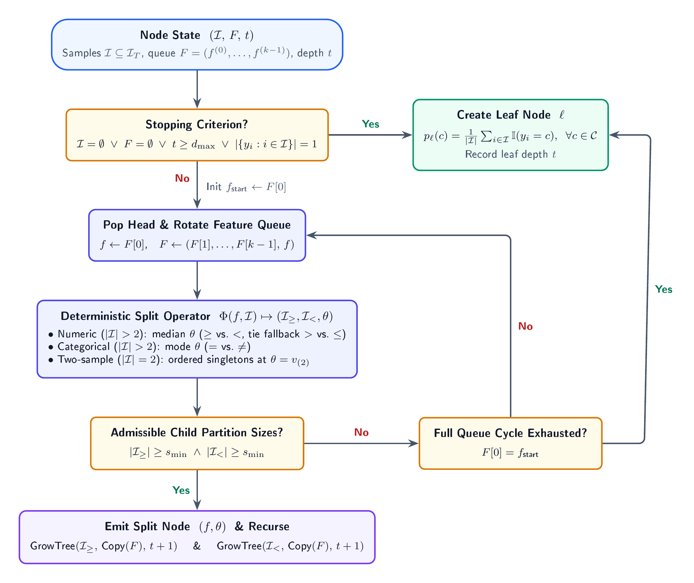

# Random Forest with Dynamic Tree Selection Based on Monte Carlo Simulation (RF-TSMC): Theoretical Formulation and Algorithmic Methodology

**Method Specification for [`random-forest-mc`](https://github.com/ysraell/random-forest-mc) (v1.5.0)**  
*Formalization of the Architecture, Learning Dynamics, Inference Rules, and Structural Explainability*

---

## Abstract

Standard Random Forest algorithms rely on bootstrap aggregating (bagging) paired with greedy, node-wise impurity minimization over the full training distribution. While effective in balanced, well-populated settings, this paradigm exhibits systematic sensitivity to class imbalance, incurs substantial split-search complexity across candidate thresholds, and optimizes decision trees strictly through local, myopic criteria. We formalize **Random Forest with Tree Selection Monte Carlo Based (RF-TSMC)**, a multiclass ensemble learning methodology that decouples local tree construction from global structural optimization. During induction, each candidate tree is grown from a small, strictly **class-balanced micro-batch** using an **impurity-free cyclic feature-queue heuristic** that applies deterministic median splits (for numeric attributes) and modal one-vs.-rest splits (for categorical attributes). Structural optimization is shifted from greedy per-node search to an outer **Monte Carlo acceptance–rejection loop** over the joint space of random feature-subspace cardinalities and feature permutations, scored against an independent, class-balanced validation batch under either a bounded-patience best-of-$`R_{\max}`$ regime or an adaptive decaying-threshold regime. At inference time, missing or omitted feature values are handled natively without prior imputation via **dual-branch tree replication**, aggregating all reachable leaves uniformly before ensemble combination through hard or soft voting, optionally weighted by each tree's survival score. Finally, because survival in the ensemble directly reflects discriminative utility across randomized subspaces, the resulting forest induces built-in marginal, pairwise, and instance-conditional feature importance measures, as well as counterfactual missing-value probability profiling and compositional forest merging.

---

## 1. Introduction and Motivation

Decision tree ensembles have long served as foundational non-parametric models for tabular classification. In classical **Random Forests (RF)** (Breiman, 2001), generalization arises from combining low-bias, high-variance trees trained on bootstrap replicates of the dataset $`\mathcal{D}`$, with feature subsampling ($`m_{\text{try}}`$) performed independently at each internal split node. In **Extremely Randomized Trees (Extra-Trees)** (Geurts et al., 2006), variance reduction is pushed further by drawing split thresholds at random rather than optimizing them exhaustively, while still evaluating an impurity score across candidate features at every node.

Despite their empirical success, classical CART-based forests share three structural constraints:

1. **Susceptibility to Class Imbalance:** Uniform bootstrap sampling replicates the empirical class distribution of $`\mathcal{D}`$. Under severe skew (e.g., rare-event or fraud detection), majority-class instances dominate both node-level impurity criteria (Gini index or Shannon entropy) and leaf posterior frequencies, degrading minority-class recall unless external resampling or cost weighting is introduced.
2. **Greedy Local Split Search:** Evaluating impurity reductions across candidate attributes and thresholds couples tree-construction cost to node sample size and feature dimensionality, while enforcing a myopic, top-down greedy heuristic that cannot evaluate the holistic discriminative power of an entire feature ordering before committing to early splits.
3. **Lack of Tree-Level Validation Filtering:** In standard bagging, every induced tree enters the ensemble regardless of out-of-sample performance on unseen samples; poorly generalizing trees created by unfavorable feature draws dilute ensemble votes with uniform weight.

**RF-TSMC** addresses these constraints through an inverted architectural principle:

> *Replace greedy, impurity-driven node optimization on skewed full-data bootstraps with ultra-fast, impurity-free deterministic splitting on class-balanced micro-batches, and delegate structural feature-subset and feature-ordering optimization to a Monte Carlo validation-selection process.*

Specifically, each tree in RF-TSMC is deliberately specialized (grown deeply on a small, class-balanced training subset $`\mathcal{I}_T`$ along a randomly ordered feature sequence $`F`$), then accepted or rejected via Monte Carlo trials against a disjoint, class-balanced validation subset $`\mathcal{I}_V`$. Only trees whose feature subspace and split sequence generalize to $`\mathcal{I}_V`$ survive into the forest.

---

## 2. Preliminaries and Notation

Let $`\mathcal{D} = \{(\mathbf{x}_i, y_i)\}_{i=1}^{M}`$ denote a supervised tabular dataset of $`M`$ complete observations (incomplete rows containing missing entries are excluded prior to training batch construction). Each observation $`\mathbf{x}_i \in \mathcal{X}`$ is described by $`d`$ predictor attributes $`\mathcal{F} = \{f_1, \dots, f_d\}`$ partitioned into:
- numeric features $`\mathcal{F}_{\text{num}} \subseteq \mathcal{F}`$, and
- categorical features $`\mathcal{F}_{\text{cat}} = \mathcal{F} \setminus \mathcal{F}_{\text{num}}`$.

The target variable takes values in a discrete label set $`\mathcal{C} = \{c_1, \dots, c_K\}`$ with $`K = |\mathcal{C}| \ge 2`$. For each class $`c \in \mathcal{C}`$, let $`\mathcal{I}^{(c)} = \{i \in \{1, \dots, M\} : y_i = c\}`$ denote its index set and $`M_c = |\mathcal{I}^{(c)}|`$ its cardinality, with minority count $`M_{\min} = \min_{c \in \mathcal{C}} M_c`$.

Table 1 summarizes the model hyperparameters and notation used throughout this formulation.

| Symbol | Parameter Name | Default | Theoretical Role |
| :--- | :--- | :---: | :--- |
| $`B`$ | `n_trees` | $`16`$ | Target number of surviving trees in the ensemble $`\mathcal{E}`$ |
| $`n_{\text{train}}`$ | `batch_train_pclass` | $`10`$ | Target number of training samples drawn per class per tree |
| $`n_{\text{val}}`$ | `batch_val_pclass` | $`10`$ | Target number of validation samples drawn per class per tree |
| $`f_{\min}, f_{\max}`$ | `min_feature`, `max_feature` | $`2, d`$ | Lower and upper bounds on sampled feature-subset size $`k`$ |
| $`\tau_0`$ | `th_start` | $`1.0`$ | Initial validation accuracy acceptance threshold |
| $`\Delta\tau`$ | `delta_th` | $`0.1`$ | Step decrement applied when relaxing $`\tau`$ (`get_best_tree=False`) |
| $`R_{\max}`$ | `max_discard_trees` | $`10`$ | Rejection patience budget before best-fallback or threshold decay |
| $`\beta_{\text{best}}`$ | `get_best_tree` | $`\text{True}`$ | Selection regime: bounded best-of-$`R_{\max}`$ vs. adaptive decay |
| $`d_{\max}`$ | `max_depth` | $`\infty^{\dagger}`$ | Maximum tree depth (root defined at depth $`t = 1`$) |
| $`s_{\min}`$ | `min_samples_split` | $`1`$ | Minimum sample cardinality required in *both* child partitions |
| $`\mathbb{I}_{\text{temp}}`$ | `temporal_features` | $`\text{False}`$ | Enforces ascending ordinal/temporal ordering on sampled $`F`$ |
| $`\sigma_{\text{soft}}, \sigma_{\text{wt}}`$ | `soft_voting`, `weighted_tree` | $`\text{False}, \text{False}`$ | Inference aggregation switches (soft vs. hard; score-weighted vs. uniform) |

*† Unbounded up to implementation recursion/depth limits ($`1000`$ in the C++ backend; system recursion limit in pure Python).*

---

## 3. Class-Balanced Micro-Batch Partitioning

For each tree-selection episode $`b \in \{1, \dots, B\}`$, RF-TSMC constructs a fresh pair of disjoint, class-balanced training and validation index sets $`(\mathcal{I}_T, \mathcal{I}_V)`$ without replacement.

Define the effective per-class sample budget:

$$
N_{\text{eff}} = \min\!\big(n_{\text{train}} + n_{\text{val}},\; M_{\min}\big), \qquad n'_ {\text{train}} = \min(n_{\text{train}}, N_{\text{eff}}), \qquad n'_ {\text{val}} = N_{\text{eff}} - n'_ {\text{train}}.
$$

For every class $`c \in \mathcal{C}`$, a subset $`S_c \subseteq \mathcal{I}^{(c)}`$ of size $`|S_c| = N_{\text{eff}}`$ is drawn uniformly without replacement and randomly partitioned into disjoint parts $`S_{c,T}`$ ($`|S_{c,T}| = n'_{\text{train}}`$) and $`S_{c,V}`$ ($`|S_{c,V}| = n'_{\text{val}}`$). The tree's training and validation batches are then:

$$
\mathcal{I}_ {T} = \bigcup_{c \in \mathcal{C}} S_{c,T}, \qquad \mathcal{I}_ {V} = \bigcup_{c \in \mathcal{C}} S_{c,V}, \qquad \mathcal{I}_ {T} \cap \mathcal{I}_ {V} = \emptyset.
$$

### Theoretical Properties of Balanced Micro-Batching

**1. Exact Class-Prior Uniformity.** Regardless of the global class frequencies $`\{M_c / M\}_{c \in \mathcal{C}}`$ in $`\mathcal{D}`$, both $`\mathcal{I}_T`$ and $`\mathcal{I}_V`$ satisfy:

$$

\mathbb{P}_ {(x, y) \sim \mathcal{I}_ {T}}(y = c) = \mathbb{P}_ {(x, y) \sim \mathcal{I}_ {V}}(y = c) = \frac{1}{K}, \qquad \forall c \in \mathcal{C}.

$$

Tree splitting and leaf frequencies are therefore structurally invariant to dataset imbalance.

**2. Equivalence of Validation Accuracy to Macro-Recall.** Because $`|\mathcal{I}_V \cap \mathcal{I}^{(c)}| = n'_{\text{val}}`$ is identical across all $`c \in \mathcal{C}`$, the empirical validation accuracy of a tree $`T`$ over $`\mathcal{I}_V`$,

$$
s(T; \mathcal{I}_ {V}) = \frac{1}{K\, n'_ {\text{val}}} \sum_{c \in \mathcal{C}} \sum_{i \in S_{c,V}} \mathbb{I}\!\big(\hat{y}_ {T}(\mathbf{x}_ {i}) = c\big) = \frac{1}{K} \sum_{c \in \mathcal{C}} \widehat{\text{Recall}}_ {c}(T; \mathcal{I}_ {V}),
$$

is identically equal to the **balanced accuracy** (macro-averaged per-class recall) on the validation batch. A tree that collapses onto a majority class achieves at most $`1/K`$ on $`s(T; \mathcal{I}_V)`$ and is rejected by the Monte Carlo filter.

**3. Dataset-Size Independence of Tree Induction.** Because $`|\mathcal{I}_T| = K \cdot n'_{\text{train}}`$ depends solely on the number of classes $`K`$ and batch parameter $`n_{\text{train}}`$, single-tree induction cost is independent of the full corpus size $`M`$ once class index buckets $`\{\mathcal{I}^{(c)}\}`$ are formed.

---

## 4. Stochastic Feature Subspace and Permutation Sampling

Before growing a candidate tree, RF-TSMC samples both the *cardinality* and the *ordered sequence* of predictor features:

**1. Cardinality Draw.** Draw $`k`$ uniformly from the discrete integer interval:

$$
k \sim \mathcal{U}\{f_{\min}, f_{\min}+1, \dots, f_{\max}\},
$$

clamped to $`1 \le f_{\min} \le f_{\max} \le d`$.

**2. Ordered Sequence Draw.** Draw an ordered tuple of $`k`$ distinct features uniformly without replacement from the space of $`k`$-permutations of $`\mathcal{F}`$:

$$
F = (f^{(0)}, f^{(1)}, \dots, f^{(k-1)}) \sim \mathcal{U}\!\left(\mathcal{P}_ {k}(\mathcal{F})\right), \qquad |\mathcal{P}_ {k}(\mathcal{F})| = \frac{d!}{(d-k)!}.
$$

### Causal / Temporal Ordering Mode ($`\mathbb{I}_{\text{temp}} = \text{True}`$)

When predictor attributes represent indexed observations (e.g., lagged features `feat_1`, `feat_2`, $`\dots`$, `feat_T` with integer suffixes $`\tau(f) \in \mathbb{Z}_{\ge 0}`$), enabling temporal feature ordering sorts the sampled tuple $`F`$ in ascending order of $`\tau(f)`$:

$$
\tau(f^{(0)}) \le \tau(f^{(1)}) \le \dots \le \tau(f^{(k-1)}).
$$

Because tree induction processes $`F`$ sequentially from root to leaves, sorting $`F`$ enforces a structural precedence in which earlier temporal states condition the upper levels of the decision tree and later states refine deeper branches.

### Contrast with Classical Subspace Randomization

In Breiman's Random Forest, the subset cardinality $`m_{\text{try}}`$ is fixed globally and candidate features are resampled at *each internal node*, where a greedy impurity optimizer determines which feature sits at the root. In RF-TSMC, both the subset size $`k`$ and the **hierarchical split order** $`F`$ are stochastic, tree-level latent variables. Consequently, different candidate trees explore distinct low-dimensional subspaces ($`k \ll d`$) as well as broader feature combinations ($`k \approx d`$), and the root split feature $`f^{(0)}`$ is directly governed by the sampled permutation rather than a greedy global criterion.

---

## 5. Impurity-Free Tree Induction via Cyclic Feature Queues

Given training index set $`\mathcal{I}_T`$ and ordered feature sequence $`F`$, a candidate decision tree $`T = \text{PlantTree}(\mathcal{I}_T, F)`$ is grown recursively from depth $`t = 1`$ without computing Gini impurity, entropy, or any target-dependent split scan.



*Figure 1: Impurity-free recursive tree induction (`PlantTree` / `GrowTree`) using deterministic median/mode splitting (`SplitData`) and cyclic feature-queue rotation.*

### 5.1 Deterministic Split Operator $`\Phi(f, \mathcal{I})`$

At an internal node containing sample indices $`\mathcal{I}`$ ($`|\mathcal{I}| \ge 2`$ with at least two distinct classes) and candidate feature $`f`$, let $`v_i = x_{i, f}`$ for $`i \in \mathcal{I}`$. The deterministic partitioning operator $`\Phi(f, \mathcal{I}) \mapsto (\mathcal{I}_{\ge}, \mathcal{I}_{<}, \theta)`$ proceeds by cases:

#### Case 1: $`|\mathcal{I}| > 2`$ and $`f \in \mathcal{F}_{\text{num}}`$ (Numeric Median Bisection)
The split threshold $`\theta`$ is the sample median ($`0.5`$-quantile) of $`\{v_i\}_{i \in \mathcal{I}}`$:

$$
\theta = \text{median}(\{v_i : i \in \mathcal{I}\}) = \begin{cases}
  v_{(\frac{n+1}{2})}, & n = |\mathcal{I}| \text{ odd}, \\
  \frac{1}{2}\!\left(v_{(\frac{n}{2})} + v_{(\frac{n}{2}+1)}\right), & n = |\mathcal{I}| \text{ even},
\end{cases}
$$

where $`v_{(1)} \le v_{(2)} \le \dots \le v_{(n)}`$ denote the order statistics of $`\{v_i\}_{i \in \mathcal{I}}`$.

The primary partition assigns:

$$
\mathcal{I}_ {\ge} = \{i \in \mathcal{I} : v_i \ge \theta\}, \qquad \mathcal{I}_ {<} = \{i \in \mathcal{I} : v_i < \theta\}.
$$

*Tie-Induced Empty-Child Fallback:* If multiple samples tie at the minimum value such that $`\theta = \min_{i \in \mathcal{I}} v_i`$, then $`\mathcal{I}_{<} = \emptyset`$. Whenever $`\mathcal{I}_{\ge} = \emptyset`$ or $`\mathcal{I}_{<} = \emptyset`$, the operator switches to strict inequality:

$$
\mathcal{I}_ {\ge} = \{i \in \mathcal{I} : v_i > \theta\}, \qquad \mathcal{I}_ {<} = \{i \in \mathcal{I} : v_i \le \theta\}.
$$

If all values in $`\mathcal{I}`$ are identical ($`v_i = \theta \;\forall i \in \mathcal{I}`$), $`\mathcal{I}_{\ge}`$ remains empty under strict inequality, signaling that $`f`$ has zero variance on $`\mathcal{I}`$ and cannot produce a valid split.

#### Case 2: $`|\mathcal{I}| > 2`$ and $`f \in \mathcal{F}_{\text{cat}}`$ (Categorical Modal Partition)
The split value $`\theta`$ is the statistical mode (most frequent category) in $`\mathcal{I}`$:

$$
\theta = \arg\max_{u} \sum_{i \in \mathcal{I}} \mathbb{I}(v_i = u).
$$

The node induces a binary one-vs.-rest categorical split:

$$
\mathcal{I}_ {\ge} = \{i \in \mathcal{I} : v_i = \theta\}, \qquad \mathcal{I}_ {<} = \{i \in \mathcal{I} : v_i \neq \theta\}.
$$

If all samples in $`\mathcal{I}`$ share a single category $`\theta`$, then $`\mathcal{I}_{<} = \emptyset`$ and the split is rejected as non-informative.

#### Case 3: $`|\mathcal{I}| = 2`$ (Minimal Two-Sample Separation)
When only two samples remain with distinct labels ($`|\mathcal{I}| = 2`$), their feature values are ordered as $`v_{(1)} \le v_{(2)}`$ corresponding to indices $`(i_{(1)}, i_{(2)})`$. The operator sets $`\theta = v_{(2)}`$ and partitions the pair into singletons:

$$
\mathcal{I}_ {\ge} = \{i_{(2)}\}, \qquad \mathcal{I}_ {<} = \{i_{(1)}\}.
$$

### 5.2 Cyclic Queue Traversal and Leaf Generation

To enforce feature diversity down every root-to-leaf path without exhausting features prematurely on deep trees, `GrowTree` maintains $`F`$ as a **cyclic FIFO queue**:

1. **Base Termination Conditions:** A leaf node $`\ell`$ is returned immediately if:
   - Depth reaches the cap: $`t \ge d_{\max}`$, or
   - Node purity is achieved: $`|\{y_i : i \in \mathcal{I}\}| = 1`$.
2. **Cyclic Feature Selection:** Let $`f_{\text{start}} = F[0]`$ be the initial head of the queue. In a loop:
   - Pop the head feature $`f \leftarrow F[0]`$ and compute $`(\mathcal{I}_{\ge}, \mathcal{I}_{<}, \theta) = \Phi(f, \mathcal{I})`$.
   - Rotate $`f`$ to the tail of the queue: $`F \leftarrow (F[1], \dots, F[k-1], f)`$.
   - **Admissibility Check:** Accept $`(f, \theta)`$ if and only if both children satisfy the minimum partition cardinality:

$$
|\mathcal{I}_ {\ge}| \ge s_{\min} \quad \text{and} \quad |\mathcal{I}_ {<}| \ge s_{\min}.
$$

   - If admissible, emit internal node $`(f, \theta)`$ and recurse independently on $`(\mathcal{I}_{\ge}, F, t+1)`$ and $`(\mathcal{I}_{<}, F, t+1)`$, each receiving a fresh copy of the rotated queue $`F`$.
   - If not admissible and the queue completes a full rotation ($`F[0] = f_{\text{start}}`$) without any feature producing an admissible split, terminate recursion and return a leaf node $`\ell`$.
3. **Leaf Empirical Distribution:** Each leaf $`\ell`$ at depth $`t`$ records the empirical class probabilities of the samples reaching it:

$$
p_{\ell}(c) = \frac{1}{|\mathcal{I}|} \sum_{i \in \mathcal{I}} \mathbb{I}(y_i = c), \qquad c \in \mathcal{C}.
$$

### 5.3 Formal Algorithm for Tree Induction

```text
Algorithm 1: Impurity-Free Cyclic-Queue Tree Induction (PlantTree)
Input : Training index set I_T, ordered feature queue F, depth bound d_max, min child size s_min
Output: Decision tree T

function GrowTree(I, F, t):
    if I is empty or F is empty or t >= d_max or |{y_i : i in I}| == 1 then
        return Leaf(p_l(c) = (1/|I|) * sum_{i in I} 1[y_i == c], depth = t)
    end if

    f_start <- F[0]
    repeat
        f <- F[0]
        (I_ge, I_lt, theta) <- SplitData(f, I)
        F <- RotateLeft(F)                    // Move f from front to back
        if |I_ge| >= s_min and |I_lt| >= s_min then
            child_ge <- GrowTree(I_ge, Copy(F), t + 1)
            child_lt <- GrowTree(I_lt, Copy(F), t + 1)
            return SplitNode(feature = f, threshold = theta,
                             branch_ge = child_ge, branch_lt = child_lt)
        end if
    until F[0] == f_start

    return Leaf(p_l(c) = (1/|I|) * sum_{i in I} 1[y_i == c], depth = t)
end function
```

### 5.4 Theoretical Insights on Tree Structure

- **Logarithmic Expected Depth on Continuous Features:** When numeric features are continuous (no ties), each median split bisects $`|\mathcal{I}|`$ into two subsets of sizes $`\lfloor |\mathcal{I}|/2 \rfloor`$ and $`\lceil |\mathcal{I}|/2 \rceil`$. Consequently, a tree grown to pure leaves on $`|\mathcal{I}_T| = K \cdot n'_{\text{train}}`$ samples has depth strictly bounded in the balanced-split regime by $`\lceil \log_2(K \cdot n'_{\text{train}}) \rceil + 1`$, preventing pathological degenerate chains that commonly occur under random-threshold or sparse categorical splitting.
- **Controlled Over-Specialization:** Growing unpruned trees ($`d_{\max} = \infty, s_{\min} = 1`$) on a small balanced subset $`\mathcal{I}_T`$ using a subset $`F`$ causes each individual tree $`T`$ to strongly fit the geometric partitioning induced by $`(F, \mathcal{I}_T)`$. Unlike classical decision trees where overfitting on the full dataset increases variance across correlated splits, here each tree specializes in a *different* low-dimensional projection $`F`$ and micro-batch $`\mathcal{I}_T`$, and must immediately prove non-trivial generalization on the disjoint validation set $`\mathcal{I}_V`$.

---

## 6. Monte Carlo Tree Selection

Because `PlantTree` executes no target-informed feature or split optimization internally, an unvalidated tree constructed from an uninformative or poorly ordered feature sequence $`F`$ may perform poorly out of sample. RF-TSMC resolves this through **Monte Carlo rejection-sampling selection** over $`(k, F)`$ conditioned on validation performance.

### 6.1 Validation Scoring Function

For each candidate tree $`T`$ planted on $`\mathcal{I}_T`$, let $`\hat{y}_T(\mathbf{x}) = \arg\max_{c \in \mathcal{C}} p_T(c \mid \mathbf{x})`$ be its hard class prediction (where $`p_T(c \mid \mathbf{x})`$ is defined in Section 7.1). The candidate's validation score on $`\mathcal{I}_V`$ is:

$$
s(T; \mathcal{I}_ {V}) = \frac{1}{|\mathcal{I}_ {V}|} \sum_{i \in \mathcal{I}_ {V}} \mathbb{I}\!\big(\hat{y}_ {T}(\mathbf{x}_ {i}) = y_i\big) \in [0, 1].
$$

(In the degenerate boundary case where $`M_{\min} \le n_{\text{train}}`$ leaves $`\mathcal{I}_V = \emptyset`$, the validation score defaults to $`1.0`$.)

### 6.2 Dynamic Acceptance–Rejection Regimes

Given a fixed batch pair $`(\mathcal{I}_T, \mathcal{I}_V)`$ for tree slot $`b`$, the selection loop initializes acceptance threshold $`\tau \leftarrow \tau_0`$, rejection counter $`r \leftarrow 0`$, best observed score $`s^* \leftarrow 0`$, and best tree $`T^* \leftarrow \varnothing`$. At each Monte Carlo iteration:

1. Draw a fresh random feature sequence $`F \sim \text{SampleFeats}(\mathcal{F})`$.
2. Induce candidate tree $`T \leftarrow \text{PlantTree}(\mathcal{I}_T, F)`$.
3. Evaluate $`s_{\text{val}} = s(T; \mathcal{I}_V)`$.
4. **Acceptance Check:** If $`s_{\text{val}} \ge \tau`$, accept $`T`$ immediately with survival score $`s_{\text{surv}}(T) = s_{\text{val}}`$ and terminate.
5. **Rejection Handling:** Otherwise ($`s_{\text{val}} < \tau`$), increment $`r \leftarrow r + 1`$. Two regimes govern budget exhaustion ($`r \ge R_{\max}`$):

**Regime A — Bounded-Patience Best-of-$`R_{\max}`$ Selection ($`\beta_{\text{best}} = \text{True}`$).** During the $`R_{\max}`$ trials, maintain the incumbent optimum:

$$
(T^{\ast}, s^{\ast}) \leftarrow \begin{cases}
  (T, s_ {\text{val}}), & \text{if } s_ {\text{val}} > s^{\ast}, \\
  (T^{\ast}, s^{\ast}), & \text{otherwise.}
\end{cases}
$$

If $`r`$ reaches $`R_{\max}`$ without meeting $`\tau_0`$, return $`T^*`$ with survival score $`s^*`$. Formally, if $`T^{(1)}, \dots, T^{(R_{\max})}`$ fail the threshold, this implements:

$$
T_ {\text{surv}} = \arg\max_{1 \le j \le R_ {\max}} s\!\left(T^{(j)}; \mathcal{I}_ {V}\right).
$$

Thus, selection stops early whenever an exceptional tree achieves $`s_{\text{val}} \ge \tau_0`$, and otherwise performs bounded random search of budget $`R_{\max}`$ over $`\bigcup_{k=f_{\min}}^{f_{\max}} \mathcal{P}_k(\mathcal{F})`$.

**Regime B — Adaptive Threshold Relaxation ($`\beta_{\text{best}} = \text{False}`$).** Once the patience counter reaches $`r \ge R_{\max}`$, subsequent rejections relax the acceptance threshold linearly on every unsuccessful trial:

$$
\tau \leftarrow \tau - \Delta\tau,
$$

while continuing to sample fresh candidate sequences $`F`$ until a candidate satisfies $`s_{\text{val}} \ge \tau`$. Because $`s_{\text{val}} \ge 0`$ and $`\tau`$ decreases monotonically by $`\Delta\tau > 0`$ after $`R_{\max}`$ rejections, termination in finite time is guaranteed.

```text
Algorithm 2: Monte Carlo Tree Selection (SurvivedTree) and Forest Assembly
Input : Dataset D, forest size B, threshold tau_0, step delta_th, patience R_max, mode beta_best
Output: Ensemble E = {(T_1, s_1), ..., (T_B, s_B)}

E <- empty list
for b = 1 to B do                               // Embarrassingly parallel across b
    (I_T, I_V) <- SplitTrainVal(D)              // Class-balanced disjoint micro-batches
    tau <- tau_0;  r <- 0;  s* <- 0.0;  T* <- None

    loop
        F <- SampleFeats(F_all)                 // Random size k and permutation
        T <- PlantTree(I_T, F)
        s_val <- Validate(T, I_V)

        if s_val >= tau then
            s_surv <- s_val;  T_surv <- T
            break
        end if

        if beta_best and s_val > s* then
            s* <- s_val;  T* <- T
        end if

        r <- r + 1
        if r >= R_max then
            if beta_best then
                T_surv <- (T* if T* != None else T);  s_surv <- max(s*, s_val)
                break
            else
                tau <- tau - delta_th
            end if
        end if
    end loop

    Record used feature subset U(T_surv) <= F
    Append (T_surv, s_surv) to E
end for
return E
```

### 6.3 Probabilistic Interpretation of Survival Selection

Fix a train–validation draw $`(\mathcal{I}_T, \mathcal{I}_V)`$, and let $`\mu_{\mathcal{F}}`$ denote the sampling distribution over feature sequences $`F`$. Define the **survival probability** at threshold $`\tau`$ as:

$$
q(\tau \mid \mathcal{I}_ {T}, \mathcal{I}_ {V}) = \mathbb{P}_ {F \sim \mu_{\mathcal{F}}}\!\big(s(T(\mathcal{I}_ {T}, F); \mathcal{I}_ {V}) \ge \tau\big).
$$

- Under **Regime A** ($`\beta_{\text{best}} = \text{True}`$), the probability that a tree passes $`\tau_0`$ within $`R_{\max}`$ trials is $`1 - (1 - q(\tau_0))^{R_{\max}}`$, and the expected number of tree evaluations is bounded strictly by $`\sum_{j=0}^{R_{\max}-1} (1 - q(\tau_0))^j \le R_{\max}`$. When no trial meets $`\tau_0`$, the output score follows the maximum order statistic $`S_{(R_{\max})} = \max_{1 \le j \le R_{\max}} S_j`$, whose cumulative distribution function is $`F_{S_{(R_{\max})}}(s) = [F_S(s)]^{R_{\max}}`$, shifting probability mass sharply toward high-performing feature subspaces.
- Under **Regime B** ($`\beta_{\text{best}} = \text{False}`$), for any threshold $`\tau_m = \tau_0 - m\,\Delta\tau`$ reached after $`R_{\max} + m`$ failures ($`m \ge 0`$), the conditional survival probability increases monotonically with $`m`$ ($`q(\tau_{m+1}) \ge q(\tau_m)`$) until $`q(\tau_m) = 1`$ for $`\tau_m \le 0`$.
- **Implicit Subspace Filtering:** Because $`(\mathcal{I}_T, \mathcal{I}_V)`$ is held fixed during the inner loop for slot $`b`$, Monte Carlo selection compares all candidate feature sequences $`F^{(1)}, F^{(2)}, \dots`$ on an *identical* train–validation benchmark. Differences in $`s_{\text{val}}`$ therefore isolate the predictive quality of the feature subspace and split order $`F`$, rather than sampling noise between different batches. Across the outer loop $`b = 1, \dots, B`$, resampling $`(\mathcal{I}_T^{(b)}, \mathcal{I}_V^{(b)})`$ decorrelates the trees across both data samples and feature subspaces.

---

## 7. Inference, Missing-Value Replication, and Ensemble Aggregation

### 7.1 Single-Tree Prediction and Missing-Feature Branch Replication

Let $`\mathbf{x}`$ be a query observation (whose schema may omit features or contain `NaN` entries). Starting at the root of tree $`T`$, traversal proceeds recursively at each internal node testing feature $`f`$ with split value $`\theta`$:

**Observed Feature Value ($`x_f`$ present and non-missing).** Traversal follows the deterministic routing function:

$$
\text{next}(\mathbf{x}; f, \theta) = \begin{cases}
  \text{branch}_ {\ge}, & \text{if } (f \in \mathcal{F}_ {\text{num}} \land x_f \ge \theta) \;\lor\; (f \in \mathcal{F}_ {\text{cat}} \land x_f = \theta), \\
  \text{branch}_ {<}, & \text{otherwise.}
\end{cases}
$$

**Missing or Omitted Feature Value ($`x_f`$ absent or `NaN`).** Instead of halting at an incomplete node, using surrogate splits, or requiring prior imputation, RF-TSMC applies **structural branch replication**: traversal forks simultaneously down *both* $`\text{branch}_{\ge}`$ and $`\text{branch}_{<}`$.

Recursively collecting all leaves reached by $`\mathbf{x}`$ yields a non-empty leaf multiset $`\mathcal{L}_T(\mathbf{x}) = \{\ell_1, \dots, \ell_m\}`$ (with $`m = 1`$ when all traversed features are observed, and $`m \le 2^{h}`$ when $`h`$ missing splits are encountered along the active paths). The tree's class posterior distribution is the normalized uniform average over all reachable leaves:

$$
\tilde{p}_ {T}(c \mid \mathbf{x}) = \frac{1}{|\mathcal{L}_ {T}(\mathbf{x})|} \sum_{\ell \in \mathcal{L}_ {T}(\mathbf{x})} p_{\ell}(c), \qquad p_T(c \mid \mathbf{x}) = \frac{\tilde{p}_ {T}(c \mid \mathbf{x})}{\sum_{c' \in \mathcal{C}} \tilde{p}_ {T}(c' \mid \mathbf{x})}, \qquad c \in \mathcal{C}.
$$

*Theoretical Interpretation:* Branch replication performs an unweighted marginalization over the missing split condition $`\mathbb{I}(x_f \ge \theta) \in \{0, 1\}`$, preserving exact compatibility with whatever subset of features *is* observed in $`\mathbf{x}`$ along each sub-branch.

### 7.2 Four-Way Ensemble Aggregation

Given the ensemble $`\mathcal{E} = \{(T_b, w_b)\}_{b=1}^{B}`$, let each tree's hard prediction be $`\hat{y}_b(\mathbf{x}) = \arg\max_{c \in \mathcal{C}} p_{T_b}(c \mid \mathbf{x})`$, and let tree weight $`w_b`$ be governed by $`\sigma_{\text{wt}}`$:

$$
w_b = \begin{cases}
  s_{\text{surv}}(T_b), & \text{if } \sigma_{\text{wt}} = \text{True (score-weighted)}, \\
  1, & \text{if } \sigma_{\text{wt}} = \text{False (uniform)},
\end{cases} \qquad W = \sum_{b=1}^{B} w_b.
$$

Combining $`\sigma_{\text{soft}} \in \{\text{False}, \text{True}\}`$ and $`\sigma_{\text{wt}} \in \{\text{False}, \text{True}\}`$ defines four ensemble probability estimators for each class $`c \in \mathcal{C}`$:

| Voting Mode | Weighting Mode | Ensemble Class Probability $`P_{\mathcal{E}}(y = c \mid \mathbf{x})`$ |
| :--- | :--- | :--- |
| **Hard** ($`\sigma_{\text{soft}} = \text{False}`$) | **Uniform** ($`\sigma_{\text{wt}} = \text{False}`$) | $`\displaystyle \frac{1}{B} \sum_{b=1}^{B} \mathbb{I}\!\big(\hat{y}_b(\mathbf{x}) = c\big)`$ |
| **Hard** ($`\sigma_{\text{soft}} = \text{False}`$) | **Weighted** ($`\sigma_{\text{wt}} = \text{True}`$) | $`\displaystyle \frac{1}{W} \sum_{b=1}^{B} s_{\text{surv}}(T_b)\,\mathbb{I}\!\big(\hat{y}_b(\mathbf{x}) = c\big)`$ |
| **Soft** ($`\sigma_{\text{soft}} = \text{True}`$) | **Uniform** ($`\sigma_{\text{wt}} = \text{False}`$) | $`\displaystyle \frac{1}{B} \sum_{b=1}^{B} p_{T_b}(c \mid \mathbf{x})`$ |
| **Soft** ($`\sigma_{\text{soft}} = \text{True}`$) | **Weighted** ($`\sigma_{\text{wt}} = \text{True}`$) | $`\displaystyle \frac{1}{W} \sum_{b=1}^{B} s_{\text{surv}}(T_b)\,p_{T_b}(c \mid \mathbf{x})`$ |

The final predicted class label is the maximum a posteriori class:

$$
\hat{y}_ {\mathcal{E}}(\mathbf{x}) = \arg\max_{c \in \mathcal{C}} P_{\mathcal{E}}(y = c \mid \mathbf{x}).
$$

*Note on Pure-Tree Leaf Purity:* When trees are grown to full purity ($`d_{\max} = \infty`$, $`s_{\min} = 1`$) and queries contain no missing values, each leaf posterior $`p_{\ell}(c)`$ collapses to a one-hot vector, making unweighted soft voting mathematically identical to unweighted hard voting. Soft voting differs whenever trees contain impure leaves (due to bounded $`d_{\max}`$, $`s_{\min} > 1`$, or exhausted feature cycles) or when missing features trigger multi-leaf replication.

### 7.3 Counterfactual Missing-Value Profiling (`predictMissingValues`)

Beyond passive robustness during prediction, RF-TSMC supports counterfactual evaluation over missing features. Given an incomplete observation $`\mathbf{x}`$ (where at least one feature $`f`$ is missing) and a candidate value dictionary $`\mathcal{V} = \{f : \text{Vals}(f)\}`$ specifying discrete candidate values for features used in the forest ($`\bigcup_{b=1}^B \mathcal{U}(T_b)`$):

1. For every missing feature $`f`$ in $`\mathbf{x}`$ appearing in $`\mathcal{V}`$ and every candidate value $`v \in \text{Vals}(f)`$, construct the counterfactual vector $`\mathbf{x}^{(f \leftarrow v)}`$ obtained by setting $`x_f \leftarrow v`$ while preserving all other entries (including any other simultaneously missing features, which remain handled by branch replication).
2. Evaluate the ensemble posterior profile $`P_{\mathcal{E}}(y = c \mid \mathbf{x}^{(f \leftarrow v)})`$ across all $`c \in \mathcal{C}`$.

This yields two analytical modes:
- **Supervised Imputation (Known Target $`y^*`$):** Select the candidate imputation $`v^* = \arg\max_{v \in \text{Vals}(f)} P_{\mathcal{E}}(y = y^* \mid \mathbf{x}^{(f \leftarrow v)})`$ that maximizes posterior support for the observed ground-truth label.
- **Unsupervised Sensitivity Analysis (Unknown Target):** Inspect whether $`P_{\mathcal{E}}(\cdot \mid \mathbf{x}^{(f \leftarrow v)})`$ varies across $`v \in \text{Vals}(f)`$. If the profile is invariant across all candidates, the missing attribute lies outside the active decision paths conditioned on the observed attributes of $`\mathbf{x}`$ and cannot influence classification confidence.

---

## 8. Structural Interpretability and Compositional Forest Operations

### 8.1 Survival-Based Feature Importance and Co-occurrence

For each surviving tree $`T_b \in \mathcal{E}`$, let $`\mathcal{U}(T_b) \subseteq F_b`$ denote the set of **actually utilized features**—i.e., the distinct features appearing in at least one internal split node of $`T_b`$ (a feature present in the sampled queue $`F_b`$ that was never split upon before reaching leaf nodes is excluded from $`\mathcal{U}(T_b)`$).

Because trees only enter $`\mathcal{E}`$ after surviving Monte Carlo selection on $`\mathcal{I}_V`$, the presence of $`f \in \mathcal{U}(T_b)`$ is itself an empirical indicator of discriminative utility. RF-TSMC defines four structural interpretability metrics over any forest $`\mathcal{E}`$ of size $`B = |\mathcal{E}|`$:

**1. Marginal Survival Importance (`featImportance`).**

$$
I_ {\mathcal{E}}(f) = \frac{1}{B} \sum_{b=1}^{B} \mathbb{I}\!\big(f \in \mathcal{U}(T_b)\big) \in [0, 1].
$$

Unlike Gini-based Mean Decrease in Impurity (MDI), which is biased toward high-cardinality continuous features with many split points, $`I_{\mathcal{E}}(f)`$ treats numeric and categorical attributes symmetrically as binary survival counts across validation-filtered trees.

**2. Conditional Mean Survival Score (`featScoreMean`).**

$$
\bar{S}_ {\mathcal{E}}(f) = \frac{\sum_{b=1}^{B} s_ {\text{surv}}(T_b)\,\mathbb{I}\!\big(f \in \mathcal{U}(T_b)\big)}{\sum_{b=1}^{B} \mathbb{I}\!\big(f \in \mathcal{U}(T_b)\big)},
$$

measuring the average generalization score of surviving trees that rely on feature $`f`$ (zero if $`f`$ never appears in $`\mathcal{E}`$).

**3. Pairwise Feature Co-occurrence Importance (`featPairImportance`).** For every unordered pair $`\{f_i, f_j\} \subseteq \mathcal{F}`$ with $`i < j`$:

$$
I_ {\mathcal{E}}(f_i, f_j) = \frac{1}{B} \sum_{b=1}^{B} \mathbb{I}\!\big(f_i \in \mathcal{U}(T_b) \land f_j \in \mathcal{U}(T_b)\big) \in [0, 1].
$$

**4. Structural Co-occurrence Matrix (`featCorrDataFrame`).** A symmetric $`d \times d`$ matrix $`\mathbf{M}_{\mathcal{E}} \in [0, 1]^{d \times d}`$ defined by:

$$
\big[\mathbf{M}_ {\mathcal{E}}\big]_ {ij} = \begin{cases}
  I_ {\mathcal{E}}(f_i), & i = j, \\
  I_ {\mathcal{E}}(f_i, f_j), & i \neq j.
\end{cases}
$$

Notice that $`\mathbf{M}_{\mathcal{E}}`$ is positive semidefinite because it can be written as the normalized Gram matrix $`\frac{1}{B}\mathbf{U}^\top \mathbf{U}`$ of the binary tree-feature incidence matrix $`\mathbf{U} \in \{0, 1\}^{B \times d}`$ with entries $`U_{bi} = \mathbb{I}(f_i \in \mathcal{U}(T_b))`$.

### 8.2 Local Sample- and Class-Conditional Explainability

To explain *why* the forest supports a specific class $`c \in \mathcal{C}`$ for an individual sample $`\mathbf{x}`$, RF-TSMC defines the **class-consistent sub-forest**:

$$
\mathcal{E}(\mathbf{x}, c) = \left\{ T_b \in \mathcal{E} : \hat{y}_ {b}(\mathbf{x}) = c \right\}.
$$

Evaluating $`I_{\mathcal{E}(\mathbf{x}, c)}(f)`$, $`\bar{S}_{\mathcal{E}(\mathbf{x}, c)}(f)`$, $`I_{\mathcal{E}(\mathbf{x}, c)}(f_i, f_j)`$, $`\mathbf{M}_{\mathcal{E}(\mathbf{x}, c)}`$, and feature-count statistics $`\{|\mathcal{U}(T_b)| : T_b \in \mathcal{E}(\mathbf{x}, c)\}`$ yields **local, sample-specific structural explanations** showing which features and synergistic feature pairs formed the decision paths of trees predicting class $`c`$ for $`\mathbf{x}`$.

### 8.3 Forest Merging and Canonical Deduplication

Because each tree $`T_b`$ is a self-contained classifier equipped with its validation score $`s_{\text{surv}}(T_b)`$, separately trained models $`\mathcal{E}_1`$ and $`\mathcal{E}_2`$ sharing identical feature space $`\mathcal{F}`$ and class space $`\mathcal{C}`$ can be composed natively via `mergeForest`:

- **Additive Union (`by="add"`):** $`\mathcal{E}_{\text{new}} = \mathcal{E}_1 \cup \mathcal{E}_2`$, enabling incremental model updates (e.g., combining historical trees trained on past data regimes with newly fitted trees on recent batches to mitigate concept drift and recency bias).
- **Elitist Score Selection (`by="score"`):** Sort $`\mathcal{E}_1 \cup \mathcal{E}_2`$ in descending order of $`s_{\text{surv}}(T)`$ and retain the top $`N`$ trees.
- **Random Subsampling (`by="random"`):** Sample $`N`$ trees uniformly without replacement from $`\mathcal{E}_1 \cup \mathcal{E}_2`$.

To preserve structural diversity after repeated merging or small feature-space training, `drop_duplicated_trees` hashes each tree's canonical key-sorted dictionary representation using MD5 ($`\text{MD5}(\text{JSON}_{\text{sorted}}(T))`$) and removes exact structural duplicates while preserving survival scores in lockstep.

---

## 9. Asymptotic Complexity and Comparative Theoretical Analysis

### 9.1 Computational Complexity

Let $`n_T = |\mathcal{I}_T| = K \cdot n'_{\text{train}}`$ and $`n_V = |\mathcal{I}_V| = K \cdot n'_{\text{val}}`$ denote the training and validation batch sizes per tree, $`L_T \le d_{\max}`$ the realized tree depth, and $`\bar{R} \ge 1`$ the expected number of Monte Carlo candidate evaluations per surviving tree.

**Single-Tree Induction (`PlantTree`).** For numeric attributes, finding the median at a node of size $`m \le n_T`$ takes $`O(m)`$ expected time via quickselect (`std::nth_element` in C++) or $`O(m \log m)`$ via full quantile/sort. For categorical attributes, modal frequency counting takes $`O(m)`$. If at most $`c_{\text{rot}} \le k`$ queue rotations occur per node and splits roughly bisect $`m`$, total work across all levels of a single tree is:

$$
O\!\big(c_ {\text{rot}} \, n_T \log n_T\big) \quad \text{(linear-median selection)}, \qquad O\!\big(c_ {\text{rot}} \, n_T \log^2 n_T\big) \quad \text{(sort-based median)}.
$$

Crucially, **this cost does not depend on the full dataset size $`M`$**.

**Single-Tree Validation (`Validate`).** Evaluating $`n_V`$ balanced validation samples down depth $`L_T`$ requires $`O(n_V \, L_T)`$ operations when features are observed.

**Full Forest Training (`fit`).** Across $`B`$ independent trees, total sequential work is:

$$
O\!\Big(B \cdot \bar{R} \cdot \big(c_ {\text{rot}} \, n_T \log n_T + n_V \, L_T\big)\Big).
$$

Because all $`B`$ tree-selection loops are mutually independent, training scales with near-linear speedup across $`P`$ parallel workers ($`O(B/P)`$ parallel steps).

**Inference (`predict`).** On complete rows, inference complexity is $`O(B \, L_T)`$ per sample. When a query encounters $`h`$ missing split features along its active paths, replication visits at most $`2^h`$ leaves in a tree (bounded by total leaves $`\le n_T`$), giving worst-case $`O(B \cdot \min(2^h L_T, n_T))`$ per sample.

### 9.2 Theoretical Comparison with Related Tree Ensembles

| Property | Classical Random Forest (Breiman, 2001) | Extra-Trees (Geurts et al., 2006) | RF-TSMC (`random-forest-mc`) |
| :--- | :--- | :--- | :--- |
| **Sample Strategy** | Full-size bootstrap ($`M`$ with replacement) | Full dataset ($`M`$, usually without bootstrap) | Class-balanced disjoint micro-batches ($`\mathcal{I}_T, \mathcal{I}_V`$) |
| **Class-Imbalance Sensitivity** | Mirrors empirical skew in $`\mathcal{D}`$ | Mirrors empirical skew in $`\mathcal{D}`$ | Structurally invariant ($`1/K`$ prior in $`\mathcal{I}_T, \mathcal{I}_V`$) |
| **Split Criterion** | Greedy Gini / Entropy maximization | Impurity evaluation over random thresholds | Impurity-free deterministic median (num.) / mode (cat.) |
| **Feature Randomization** | Fixed $`m_{\text{try}}`$ resampled at every node | Fixed $`K_{\text{attr}}`$ resampled at every node | Random cardinality $`k \in [f_{\min}, f_{\max}]`$ & cyclic queue $`F`$ per tree |
| **Structural Optimization** | Greedy local node selection | Greedy selection among random cut-points | Monte Carlo tree-level acceptance–rejection on $`\mathcal{I}_V`$ |
| **Tree Acceptance Filter** | None (all induced trees kept) | None (all induced trees kept) | Survival threshold $`\tau`$ (best-of-$`R_{\max}`$ or $`\Delta\tau`$ decay) |
| **Missing-Data Inference** | Requires imputation / surrogate splits | Requires imputation / surrogate splits | Native dual-branch replication ($`\mathcal{L}_T(\mathbf{x})`$ averaging) |
| **Feature Importance** | MDI / Permutation importance | MDI / Permutation importance | Survival selection frequency $`I_{\mathcal{E}}(f)`$ & co-occurrence $`\mathbf{M}_{\mathcal{E}}`$ |
| **Model Composition** | Tree union (no per-tree validation score) | Tree union (no per-tree validation score) | Native merging (`add`, `score`, `random`) & MD5 deduplication |

---

## 10. Theoretical Assumptions, Trade-Offs, and Design Considerations

A rigorous understanding of RF-TSMC also illuminates the theoretical conditions governing its behavior:

1. **Resolution Quantization of Validation Scores:**  
   Since $`|\mathcal{I}_V| = K \cdot n'_{\text{val}}`$, validation accuracy $`s(T; \mathcal{I}_V)`$ is quantized to integer multiples of $`(K \cdot n'_{\text{val}})^{-1}`$. When $`K \cdot n'_{\text{val}}`$ is small, multiple candidate trees share identical validation scores, reducing tie-breaking resolution in `get_best_tree` ranking and weighted voting. Increasing $`n_{\text{val}}`$ refines the resolution of the Monte Carlo objective at the cost of $`O(n_{\text{val}} L_T)`$ validation time per trial (subject to $`n_{\text{train}} + n_{\text{val}} \le M_{\min}`$).
2. **Bias–Variance Trade-Off in Batch Sizes ($`n_{\text{train}}`$ vs. $`n_{\text{val}}`$):**  
   Larger $`n_{\text{train}}`$ enables deeper decision boundaries and finer local partitioning within each tree, reducing individual-tree bias; however, for small datasets where $`M_{\min}`$ is constrained, increasing $`n_{\text{train}}`$ shrinks $`n_{\text{val}}`$ (or forces overlapping training pools across trees), increasing the variance of the validation filter $`s(T; \mathcal{I}_V)`$.
3. **Axis-Aligned Univariate Median/Mode Inductive Bias:**  
   Because internal splits test single features at their median or mode without greedy multi-threshold scanning, linear oblique boundaries or sharply asymmetric bimodal thresholds on a single feature may require multiple cyclic passes through $`F`$ (i.e., deeper paths or multiple splits along the same feature at different depths) to approximate.
4. **Minimum Class Cardinality Requirement:**  
   Constructing disjoint non-empty $`\mathcal{I}_T`$ and $`\mathcal{I}_V`$ requires $`M_{\min} \ge 2`$ (and practically $`M_{\min} \ge n_{\text{train}} + n_{\text{val}}`$ to realize the full configured batch sizes).
5. **Combinatorial Complexity of Dual-Branch Replication:**  
   When an inference query omits or masks $`h`$ features along a tree's paths, leaf collection grows as $`O(2^h)`$ up to the tree's leaf count ($`O(n_T)`$). Because $`n_T`$ is deliberately bounded by balanced micro-batching, worst-case traversal remains bounded by tree size rather than full dataset size $`M`$.

---

## 11. Summary

RF-TSMC formulates ensemble classification as a two-level stochastic architecture: an **inner deterministic constructor** that builds compact, class-balanced, impurity-free decision trees along cyclic feature queues, paired with an **outer Monte Carlo selection mechanism** that filters feature subspaces and split permutations by out-of-sample balanced validation accuracy. This separation yields natural robustness against severe class imbalance, dataset-size-independent tree induction, embarrassingly parallel training, imputation-free missing-value inference via path replication, survival-driven global and local explainability, and native model compositionality.

---

## References

1. Breiman, L. (2001). *Random Forests*. Machine Learning, Springer.
2. Geurts, P., Ernst, D., & Wehenkel, L. (2006). *Extremely randomized trees*. Machine Learning, Springer.
3. Ho, T. K. (1998). *The random subspace method for constructing decision forests*. IEEE Transactions on Pattern Analysis and Machine Intelligence.
4. Oliveira, I. *random-forest-mc: Random Forest with Tree Selection Monte Carlo Based (v1.5.0)*. GitHub repository: [https://github.com/ysraell/random-forest-mc](https://github.com/ysraell/random-forest-mc).
5. Oliveira, I. *Laboratory of Decision Tree and Random Forest (`random-forest-lab`)*. GitHub repository: [https://github.com/ysraell/random-forest-lab](https://github.com/ysraell/random-forest-lab).
